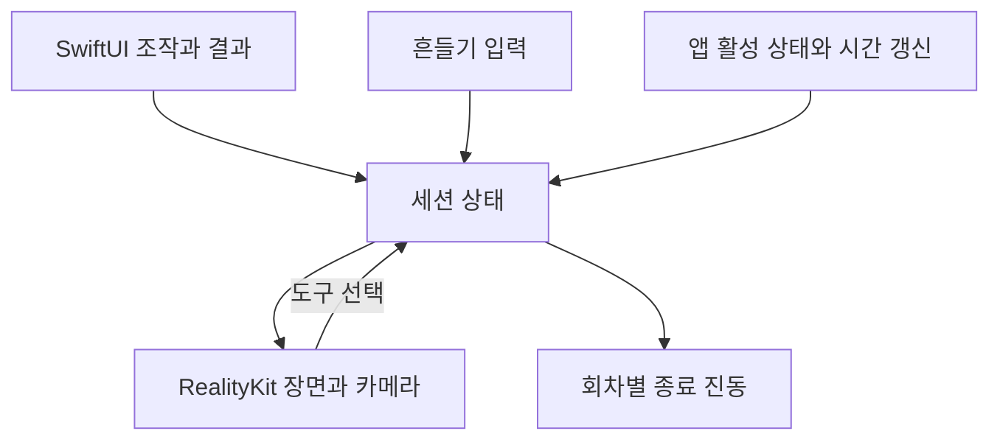
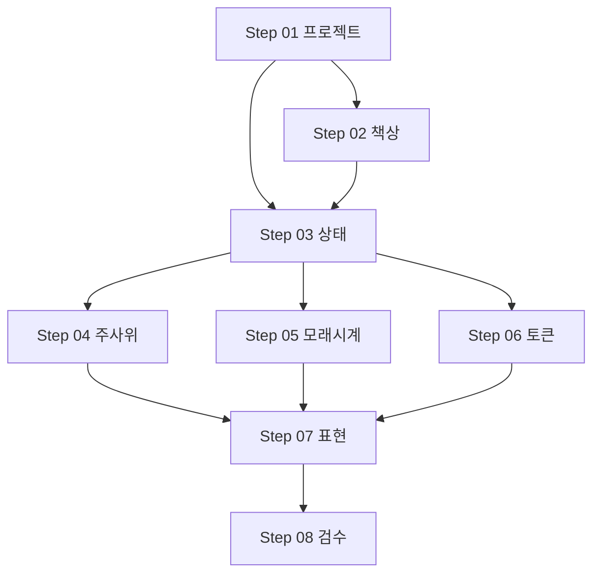

# BoardMate(보드메이트) 단계별 개발 계획

## 목표와 완료 범위

Xcode에서 SwiftUI와 RealityKit을 사용해 iOS 26 이상 BoardMate를 구현한다. 처음부터 실제 사용할 주사위·모래시계·토큰의 3D 형태와 기본 빈티지 재질을 구성하고, 같은 엔티티 구성에 세션 상태와 동작을 연결한다. 별도의 단순 도형 시제품을 완성한 뒤 최종 모델로 다시 구현하는 단계는 두지 않는다.

2026-10-27 사용자 결정으로 PRD 09절의 납품 순서를 변경한다. 기능 범위와 검수 기준은 유지하되, 3D 제작을 Step 02 및 각 도구 구현 단계로 앞당긴다. 원본 PRD는 보존하며 구현 순서는 이 계획과 Step 문서를 따른다.

이 문서와 Step 문서는 **실행 계획**이다. 현재 생성하는 것은 프로젝트 기본 골격이며, 세 도구가 구현되었다는 의미가 아니다. 모든 구현 경로는 이 문서가 속한 프로젝트 루트를 기준으로 한다.

완료 조건은 PRD의 COM-01~03, DIC-01~06, TIM-01~06, TOK-01~05와 A-01~12 충족, 미정 정책의 결정 기록, 실기기 검수 증거다. 배포·App Store 등록은 이번 완료 조건에 포함하지 않는다.

---

## 기준 자료와 현재 환경

- 기준: [PRD v0.2](boardgame-tools-prd.html), 작성일 2026-10-26. PRD의 작업명은 앱 이름 BoardMate로 사용한다.
- 기존 형제 프로젝트 BoardGameBox는 SwiftUI 제목과 동작 없는 버튼만 있는 iOS 16.4 프로젝트다. 재사용할 게임 로직·3D 자산·테스트가 없어 별도 신규 프로젝트로 구성한다.
- 관련 기존 기술 전략, 계획, 학습 문서는 발견되지 않았다. 기존 아키텍처를 그대로 승계할 근거가 없다.
- 초기 활성 개발자 경로는 Command Line Tools였다. Step 01 재검증에서 `~/Downloads/Xcode.app`의 Xcode 26.2와 iOS 26.2 SDK를 확인하고 작업별 `DEVELOPER_DIR` 지정으로 Debug·Release 빌드·정적 분석 및 iPhone 17 Pro / iOS 26.3.1 기본 화면 실행을 완료했다.
- 2026-10-27 Step 01 사용자 결정: iPhone·세로 방향을 지원한다. 실기기 모델·OS는 추후 제공하며 아직 선정되지 않았다.
- Step 01에서 Bundle Identifier를 `com.yanghojoon.BoardMate`로 설정하고 프로젝트에 추가된 개발 팀 `FA464JRW3F`를 보존했다. 사용자가 팀·기기 등록 이슈를 수정했다. 시뮬레이터 검증은 통과했으며 실기기 서명·실행 증거는 후속이다. 현재 환경과 남은 실행 검증은 [Step 01 검증 기록](Step-01-Verification.md)을 따른다.

---

## 확정 범위와 제외 범위

| 영역    | 반드시 제공할 동작                                               | 주요 검수                    |
| ----- | -------------------------------------------------------- | ------------------------ |
| 책상    | 같은 공간에 세 도구, 탭 시 클로즈업, 전환 중 데이터 유지·입력 일관성                | COM-01~03, A-07          |
| 주사위   | D6 1~10개, 초기 2개, 버튼·흔들기, 결과와 눈금 일치, 중복 굴림 차단             | DIC-01~06, A-01·09·10    |
| 모래시계  | 초기 3분·대기, 양수 시간 설정, 시작·리셋, 전환·세션 복귀 경과 반영, 활성 중 종료 진동 1회 | TIM-01~06, A-02~04·11·12 |
| 토큰    | 1·5·10·20·50, 초기 미지급, 단위별 누적 추가와 보유량 이내 제거               | TOK-01~05, A-05          |
| 공통 품질 | 잘못된 입력 거부, 새 실행 초기화, 수치 가독성·접근성·성능                       | A-06·08, PRD 06·07절      |

자유 카메라, 꾸미기·테마, 다른 면수 주사위, 결과 기록·통계, 주사위별 잠금, 다중 타이머·일시정지, 개별 모래알 물리, 총액 자동 환전, 사용자 정의 단위, 플레이어별 자산, 영구 저장, 로그인·서버·동기화·멀티플레이는 제외한다. 별도 소리·푸시 알림도 확정 범위에 넣지 않는다.

---

## 미정 정책과 결정 시점

아래 항목 중 P-01의 iPhone·세로 방향만 사용자 확정 사항이다. 나머지 **제안은 사용자 확정 사항이 아니다.** 해당 기능 구현 전 결정 결과를 이 표에 기록한다. 확정 범위를 늘리는 선택은 별도 논의한다.

| ID   | PRD 미정 항목         | 계획용 제안                                                                                           | 결정 시점                                  |
| ---- | ----------------- | ------------------------------------------------------------------------------------------------ | -------------------------------------- |
| P-01 | 지원 기기·방향          | 2026-10-27 사용자 확정: iPhone·세로 방향, iPad 제외. 검수 실기기 모델·OS는 추후 제공 예정.                         | Step 01, 실기기 기준은 Step 02 전             |
| P-02 | 굴림 도중 전환          | 시작 시 결과를 고정하고 화면 밖에서도 회차를 한 번 완료한다. 복귀 시 새 난수 생성 없이 결과로 정렬한다.                                    | Step 04 전                              |
| P-03 | 대기 중 주사위 개수 변경    | 다음 굴림 설정과 직전 결과 당시의 개수를 구분해 표시한다. 이전 결과를 잘라내거나 복제하지 않는다.                                         | Step 04 전                              |
| P-04 | 시간 단위·상한·실행 중 변경  | 분·초 입력, 1초~59분 59초. 실행 중 설정 변경은 차단하고 리셋 후 변경한다.                                                  | Step 05 전                              |
| P-05 | 비활성·잠금 중 만료 진동    | 비활성 중 전달을 보장하지 않고, 복귀에서는 종료 상태만 반영하는 방향을 제안한다. 활성 중 만료 진동 1회는 필수다.                               | Step 05 전                              |
| P-06 | 토큰 수량 상한·쌓임·제거 UI | 단위별 보유 0~100개, 한 번의 추가도 잔여 한도 이내. 10개 높이 스택으로 나누고 단위 선택+제거 개수 입력을 제공한다.                          | Step 06 전, 성능은 Step 08 재확인             |
| P-07 | 토큰 빈 값·0·일괄 적용    | 미사용 단위는 명시적 0, 빈 값은 오류. 전 항목 검증 후 한 번에 반영하며 전체 0은 추가 없이 유지한다. 첫 입력 취소 후 재진입하면 다시 입력을 제공한다.       | Step 06 전                              |
| P-08 | 프레임·기기·전환 시간      | 후보 최저 성능 기기에서 60fps를 우선 목표로 측정하고, 미달 시 효과를 줄여 재측정한다. 전환은 약 0.3~0.5초를 시도한다. 최종 통과 기준은 측정 전에 고정한다. | Step 02에서 기기·전환 검토, Step 08 전 성능 기준 확정 |

시간 상한과 토큰 상한이 바뀌면 관련 입력 경계 테스트와 성능 최악 조건을 함께 갱신한다. 화면을 만들기 위해 임시 선택한 값이 PRD의 확정 정책으로 바뀌지 않도록 구분한다.

---

## 기술 설계와 선택 이유

| 결정     | 설계 방향                                                                 | 이유                                               |
| ------ | --------------------------------------------------------------------- | ------------------------------------------------ |
| 화면     | SwiftUI로 입력·결과·접근성, RealityKit으로 책상·도구·연출                             | 수치를 3D에만 의존하지 않으며 PRD의 엔진 결정을 따른다.               |
| 렌더링    | 비 AR 가상 공간. RealityView의 가상 카메라 경로를 우선 검증                             | 실제 카메라·현실 추적이 제품 흐름에 필요하지 않다.                    |
| 카메라 검증 | Step 02에서 프로그램에 의한 시점 제어·도구 탭을 검증. 필요하면 RealityKit ARView 비 AR 경로를 비교 | 렌더러 래퍼 선택을 초기 기술 검증으로 좁히고, 도메인 로직이 영향을 받지 않게 한다. |
| 상태 소유  | 루트가 한 세션 상태를 소유. 주사위·시간·토큰과 선택 상태를 하위 화면에 전달                          | 카메라 또는 SwiftUI 화면 재생성으로 데이터가 사라지지 않는다.           |
| 상태 변경  | UI·모션·완료 이벤트가 같은 상태 변경 경로로 들어가도록 하고 UI 상태는 MainActor에서 직렬 처리          | 버튼·흔들기 동시 입력과 늦은 완료 콜백 충돌을 차단한다.                 |
| 주사위    | 균등 난수로 결과를 먼저 선택하고 해당 눈금으로 최종 회전 정렬                                   | 물리 정지 자세를 판독하는 복잡도를 줄이고 결과 일치를 보장한다.             |
| 3D 제작   | Step 02에서 도구별 EntityFactory와 실제 형태·기본 재질을 만들고 Step 04~06에서 같은 구성을 확장 | 임시 도형과 최종 모델의 이중 구현을 피하고 실제 형상으로 선택·카메라를 검증한다. |
| 시간     | 종료 기준 시각과 현재 시각의 차이로 잔여 시간 계산. 테스트용 시계 주입                             | 렌더링 프레임과 앱 비활성 동안의 갱신 중단에 영향받지 않는다.              |
| 토큰     | 수량은 모델에서 검증·변경하고 3D는 그 값을 반영. 고정 스택과 짧은 연출 사용                         | 화면상의 토큰 엔티티 수를 잔액의 원본으로 사용하지 않는다.                |
| 테스트    | 순수 로직은 Swift Testing, 화면 통합은 XCTest UI 테스트, 흔들기·진동·성능은 실기기            | 빠른 반복 검증과 하드웨어 증거를 구분한다.                         |

영구 저장소·네트워크·외부 패키지·범용 서비스 계층은 추가하지 않는다. 테스트를 위해 시계·난수·진동 경계만 필요한 만큼 분리한다. 새 Swift 파일에는 작성자 양호준의 Xcode 형식 헤더를 넣는다.

RealityKit은 장면·재질·엔티티·연출을 담당하며, 상세 메시나 텍스처를 자동 제작하는 도구로 간주하지 않는다. 기본 메시 조합 또는 프로젝트에 포함한 로컬 자산으로 실제 사용할 형태를 제작한다. 기본 메시 조합도 눈금·유리·모래·각인·재질을 갖춘 최종 도구의 구성 요소로 사용하며, 임시 대체 모델 제작과 구분한다. 외부 제작 자산이 필요하면 출처·사용 권한을 기록하고 피벗·축·스케일·하위 엔티티 이름을 유지한다. 자산 제작 방법은 Step 02에서 정하고 외부 자산 확보를 기능 연결의 숨은 선행 조건으로 남기지 않는다.

다음 그림은 설계 방향을 설명하는 자료이며, 구현 코드를 고정하는 명세가 아니다.



화면 전환은 상태를 읽는 표현의 변경이다. 타이머 갱신이나 종료 감지는 모래시계 화면이 사라져도 루트 세션에서 유지한다. 카메라 이동 완료는 최신 선택 요청 번호와 일치할 때만 반영한다. 주사위 완료는 현재 선택 도구와 무관하게 해당 굴림 회차의 유효성으로 검증하며, 타이머 종료도 자신의 실행 회차를 기준으로 검증한다.

---

## 예상 프로젝트 구조

```text
BoardMate/
├── BoardMate.xcodeproj/
├── BoardMate/
│   ├── App/
│   │   └── BoardMateApp.swift # 앱 진입점, 세션 상태는 Step 03
│   ├── Features/
│   │   ├── Tabletop/
│   │   │   └── ContentView.swift # 기본 SwiftUI 화면
│   │   ├── Dice/
│   │   ├── Hourglass/
│   │   └── Tokens/
│   ├── Scene/               # RealityKit 예정 경로, 현재 README만 존재
│   ├── Infrastructure/      # 모션·시계·진동 경계
│   └── Resources/           # 3D 모델·재질
├── BoardMateTests/          # Step 03 이후 추가
├── BoardMateUITests/        # Step 02 이후 추가
└── Docs/
    ├── README.md
    ├── boardgame-tools-prd.html
    ├── 2026-10-27-001-feat-boardmate-mvp-plan.md
    └── Steps/
```

App·Features/Tabletop은 기본 SwiftUI 소스가 있는 경로이며 Scene은 README만 있는 RealityKit 예정 경로다. 나머지 Features·Infrastructure·테스트·3D 리소스는 후속 Step의 예정 경로이며 구현 완료로 간주하지 않는다.

---

## 단계별 실행 순서

| 단위           | 작업 문서                                           | 핵심 산출물                    | 선행 작업    |
| ------------ | ----------------------------------------------- | ------------------------- | -------- |
| U1 / Step 01 | [프로젝트와 정책](Steps/Step-01-Project-Foundation.md) | iOS 26 프로젝트, 실행 환경, 정책 기록 | 없음       |
| U2 / Step 02 | [책상과 카메라](Steps/Step-02-Tabletop-Camera.md)     | 실제 도구 형태·기본 재질·선택·시점 전환 | U1       |
| U3 / Step 03 | [세션 상태](Steps/Step-03-Session-State.md)         | 화면과 분리된 상태·입력 규칙·시간 경계    | U1·U2    |
| U4 / Step 04 | [주사위](Steps/Step-04-Dice.md)                    | 실제 주사위의 굴림·눈금 정렬·버튼·흔들기·중복 방지 | U2·U3 |
| U5 / Step 05 | [모래시계](Steps/Step-05-Hourglass.md)              | 실제 모래시계의 모래 진행·시작·리셋·복귀·진동 | U2·U3 |
| U6 / Step 06 | [토큰](Steps/Step-06-Tokens.md)                   | 각인된 동전의 단위별 추가·제거·스택 연출 | U2·U3 |
| U7 / Step 07 | [표현과 접근성](Steps/Step-07-Art-Accessibility.md)   | 기존 자산의 재질·조명 조정·가독성·접근성 | U4·U5·U6 |
| U8 / Step 08 | [통합 검수](Steps/Step-08-MVP-Verification.md)      | A-01~12 증거·성능 측정·잔여 이슈    | U7       |

기본은 Step 순서대로 진행한다. U4·U5·U6는 공통 상태 계약이 안정된 뒤 독립적으로 작업할 수 있다. U-ID는 문서 수정 시에도 유지한다.



PRD의 납품 순서에 대한 변경: 공간·전환과 실제 3D 형태·기본 빈티지 표현=Step 01~02, 기능·상태와 도구별 연출=Step 03~06, 표현 조정·접근성=Step 07, MVP 검수=Step 08. Step 07에서 도구 모델을 전면 교체하지 않는다.

---

## 통합 영향과 오류 처리

- 도구 선택·카메라·SwiftUI 패널은 하나의 선택 상태를 공유한다. 전환 중 도구 실행은 차단하고 마지막 유효한 선택으로 이동을 재지정한다.
- 입력 오류는 필드 가까이에 수정 가능한 안내로 표시한다. 오류가 발생하면 마지막 유효 모델 상태를 유지한다.
- 주사위·타이머의 회차 ID는 이전 작업의 지연 완료를 무효화한다. 리셋·재시작·비활성 전환 후 취소되거나 늦게 도착한 콜백도 검수한다.
- 앱 비활성 시 렌더링·불필요한 화면 갱신은 중지할 수 있지만 종료 기준 시각은 보존한다. 활성 복귀 때 잔여 시간과 3D 표현을 먼저 맞춘다.
- 진동 발생 여부는 특정 패널이 아닌 세션 회차에 기록한다. 지원 기기에서 진동이 나지 않아도 종료 숫자와 상태는 표시한다.
- 3D 자산 로딩 실패는 대체 도형과 일반 UI로 드러내며, 조작 가능 상태와 시각 상태의 불일치를 남기지 않는다.
- 앱 프로세스를 새로 시작하면 주사위 2개, 모래시계 3분·대기, 토큰 0개다. 홈 화면·잠금 후 같은 프로세스로 돌아오는 경우와 구분한다.
- 별도 사용자 데이터·외부 API가 없어 마이그레이션이나 서버 배포는 필요하지 않다.

---

## 검증 전략과 완료 증거

기능별 단위 테스트 → 도구 왕복 UI 통합 → 실기기 검수 순으로 진행한다. 임의 대기 대신 주입한 시계와 난수로 경계를 재현한다. 3D 최종 눈금·유리 가독성·물리적 진동은 모의 객체만으로 통과 처리하지 않는다.

Step 08에서 `Docs/QA/MVP-Verification.md`에 A-01~12별 상태·기기·OS·재현 절차·결과·스크린샷 또는 영상 경로를 기록한다. 단위·UI 테스트 결과와 Xcode 빌드·정적 분석 결과를 첨부한다. 실기기를 사용하지 못한 항목은 “미검증”으로 남기고 MVP 완료로 보고하지 않는다.

| 위험                     | 대응                                    |
| ---------------------- | ------------------------------------- |
| 가상 카메라·탭 API 통합 불확실성   | Step 02에서 렌더러와 시점 이동을 먼저 검증하고 경로를 고정  |
| 연출 완료에 상태를 의존해 입력이 잠김  | 회차별 모델 완료·복귀 정합성 검수                   |
| 화면 밖 타이머 중단·진동 중복      | 루트 세션 감지, 종료 기준 시각, 회차별 단일 전달         |
| 많은 토큰·투명 유리·그림자의 비용    | 수량 한도 확정, 공유 자산·스택, 실제 기기 프레임·메모리 측정  |
| 상세 3D 자산 제작이 초기 일정을 지연 | Step 02에서 제작 경로·필수 디테일을 확정하고 장식 세부 묘사는 제한한다. 같은 엔티티를 개선하며 재구현하지 않는다. |
| 지원 기기·상한이 미정인 채 검수 진행  | 정책별 결정 시점 준수, 확정 전 최종 합격 판정 보류        |

일정은 담당 인원·3D 자산 공급·실기기 확보가 정해진 후 산정한다. Step 단위 완료 기준을 충족할 때 다음 단계로 진행하며, 기능 구현 중 범위 밖 요구는 별도 후속 작업으로 분리한다.

---

## 공식 기술 참고

- [RealityView](https://developer.apple.com/documentation/realitykit/realityview): SwiftUI 안의 3D 표현을 위한 검토 대상.
- [RealityViewCamera.virtual](https://developer.apple.com/documentation/realitykit/realityviewcamera/virtual): 비 AR 가상 카메라 검토 기준.
- [ScenePhase](https://developer.apple.com/documentation/swiftui/scenephase): 활성·비활성 전환 감지 근거.
- [UIResponder.motionEnded](https://developer.apple.com/documentation/uikit/uiresponder/motionended(_:with:)): 흔들기 이벤트 연결 검토 기준.
- [SensoryFeedback](https://developer.apple.com/documentation/swiftui/sensoryfeedback): SwiftUI 진동 경계 검토 기준.
- [PRD에 포함된 WWDC25 자료](https://developer.apple.com/videos/play/wwdc2025/288/): RealityKit 전환 배경. PRD의 엔진 선택을 변경하지 않는다.
